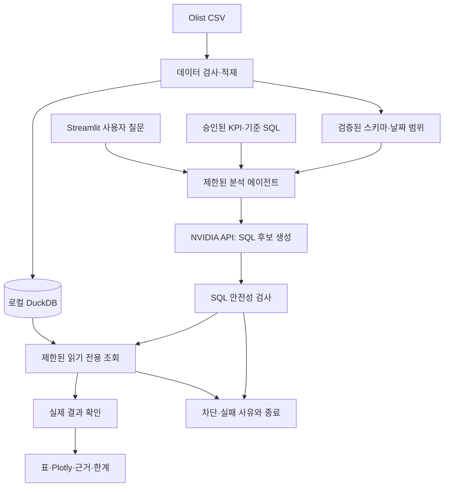

# InsightAgent

NVIDIA AI 기반 이커머스 데이터 분석 에이전트입니다. 실제 Olist 데이터를 대상으로 한국어 질문을 SQL 분석과 시각화로 연결하는 서비스를 단계별로 개발합니다.

## 현재 상태

- 2026-10-23: Phase 0 설계 사용자 승인 완료.
- 2026-10-24: Phase 1 정적 역분석 재검토 완료. Vanna 실행 시연은 미검증입니다.
- Phase 2: 가상환경·의존성 설치·환경 동작 확인 완료. Olist 원본 다운로드와 데이터 구축은 대기 중입니다.
- 현재 실행할 수 있는 코드는 환경 확인 스크립트입니다. 분석 앱·KPI·API 연결은 이후 단계에서 구현합니다.

## MVP

- 월별 매출·주문수, 매출 상위 상품 카테고리, 배송 지연, 배송 지연과 평점 관계.
- 실행 SQL, 실제 조회 결과, Plotly 그래프, KPI 기준, 분석 근거와 한계 표시.
- 데이터 부재, 모호한 질문, 위험 SQL, API 오류에 대한 종료와 설명.
- 고객 리뷰 검색·불만 분석은 Phase 7에서 확장합니다.

## 예정 기술

Python · DuckDB · pandas · Streamlit · Plotly · NVIDIA Build API · pytest · Git.

Vanna는 역분석 대상으로 참고하고, 서비스는 필요한 흐름을 작게 직접 구현합니다. 별도 프론트엔드 서버·벡터 DB·대형 에이전트 프레임워크는 MVP 범위에 포함하지 않습니다.



위 구조는 설계안이며 아직 구현되지 않았습니다. KPI는 실제 데이터 조사 후 사용자 승인으로 확정합니다.

## 문서 안내

- [협업 규칙](AGENTS.md)
- [프로젝트 계획과 현재 상태](docs/PROJECT_PLAN.md)
- [기술 의사결정](docs/DECISIONS.md)
- [Vanna 역분석](docs/REVERSE_ENGINEERING.md)
- [학습 기록](docs/LEARNING_LOG.md)
- [검증 근거](docs/TEST_EVIDENCE.md)

## 환경 설정과 직접 확인

검증 환경은 Windows x64, Python 3.11.0, uv 0.10.6입니다. 직접 의존성은 DuckDB 2.0.0, pandas 3.1.0, pytest 9.1.1이며 하위 의존성까지 `requirements.txt`에 버전·배포 파일 해시를 고정했습니다.

현재 PC의 `.venv`는 이미 준비되어 있습니다. PowerShell에서 프로젝트 폴더로 이동한 뒤 실행합니다. 가상환경 활성화나 PowerShell 실행 정책 변경은 필요하지 않습니다.

```powershell
uv pip check --python .venv/Scripts/python.exe
.\.venv\Scripts\python.exe scripts/check_environment.py
```

환경 확인 스크립트는 실제 Olist 대신 작은 합성 CSV를 사용해 한글, 정확한 소수 금액, 날짜·NULL, CTE 조회, pandas와 DuckDB 사이 변환을 메모리에서 확인합니다. 예상 출력의 마지막 두 줄은 `PASS`입니다. API 호출과 원본 파일 변경은 없습니다.

새 체크아웃에서 Python 3.11과 uv가 설치되어 있고 `.venv`가 없을 때만 다음 순서로 재구성합니다.

```powershell
uv venv .venv --python 3.11 --no-python-downloads
uv pip sync requirements.txt --python .venv/Scripts/python.exe --default-index https://pypi.org/simple --require-hashes --only-binary :all:
uv pip check --python .venv/Scripts/python.exe
.\.venv\Scripts\python.exe scripts/check_environment.py
```

`requirements.in`은 직접 사용하는 패키지 목록, `requirements.txt`는 검증한 설치 버전과 하위 의존성 기록입니다. 일반적인 환경 복원에는 `sync`만 사용합니다. 의존성 변경이 승인된 경우에만 입력 목록을 수정하고 아래 명령으로 설치 기록을 다시 생성한 뒤 재검증합니다.

```powershell
uv pip compile requirements.in --python .venv/Scripts/python.exe --default-index https://pypi.org/simple --generate-hashes --output-file requirements.txt --quiet
```

Python 3.11과 Windows x64에서 확인한 구성입니다. 다른 운영체제·Python 버전의 호환성은 아직 검증하지 않았습니다. uv 사용법은 [가상환경](https://docs.astral.sh/uv/pip/environments/)과 [의존성 고정·동기화 공식 문서](https://docs.astral.sh/uv/pip/compile/)를 참고합니다.

아직 앱 테스트는 없습니다. `python -m pytest --version`은 pytest 설치 확인이며 테스트 통과 결과가 아닙니다.

## Olist 수동 다운로드

1. [Olist 데이터 페이지](https://www.kaggle.com/datasets/olistbr/brazilian-ecommerce)를 엽니다.
2. 상단 **Download → Download dataset as zip**을 선택합니다. 로그인 요청이 나오면 로그인합니다.
3. ZIP의 압축을 풀고 CSV 파일들을 프로젝트의 `data/raw/` 바로 아래에 넣습니다. 파일명과 내용을 유지합니다.
4. 파일을 넣은 뒤 아래 명령으로 목록을 확인하고 데이터 구축 단계로 진행합니다.

```powershell
Get-ChildItem .\data\raw -Filter *.csv | Select-Object Name
```

`data/raw/`와 `data/processed/` 폴더는 준비되어 있습니다. 웹사이트에 표시되는 kagglehub 코드는 수동 다운로드에 필요하지 않습니다. 2026-10-24 사용자 확인 기준으로 원본은 아직 미다운로드 상태이며 실제 기간·행 수·품질·KPI는 조사하지 않았습니다.

## 데이터·보안

- 데이터 출처: [Olist Brazilian E-Commerce Public Dataset](https://www.kaggle.com/datasets/olistbr/brazilian-ecommerce).
- 원본과 생성 DB는 로컬에서 관리합니다. 배포 데이터 버전·라이선스·재배포 조건은 Phase 2에서 확인합니다.
- `.env`, 가상환경, 원본 데이터와 생성 DB는 Git에서 제외합니다.
- SQL 생성과 실행을 분리하고, 조회 전용·외부 접근 차단·리소스 제한을 검증한 경로로 실행할 예정입니다.
- 실 API 호출, Git push, 배포는 승인된 범위에서만 진행합니다.

프로젝트 저장소: [jinjerry0927/InsightAgent](https://github.com/jinjerry0927/InsightAgent).
