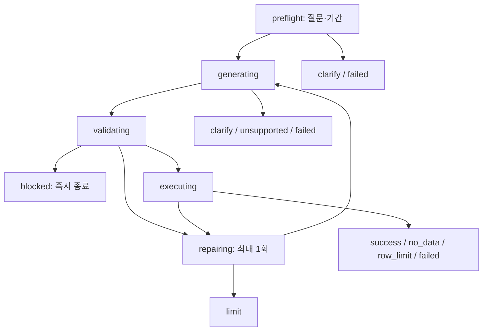

# Phase 5 분석 에이전트

기준일: 2026-10-30. 구현·오프라인·실제 DB·한국어 실 API 최소 검증과 최종 재검토를 완료했고 사용자 다음 단계 승인을 반영했다. 화면은 [Phase 6](PHASE6_DASHBOARD.md)에서 연결했다.

## 이번 단계에서 연결한 것

질문과 선택 기간 → NVIDIA의 JSON/SQL 응답 → SQL 구문·접근 정책 → 승인 KPI 구조 대조 → 별도 프로세스의 제한된 조회 → 실제 결과·SQL·근거·종료 상태를 연결한다. 수치를 설명하는 추가 LLM 호출은 하지 않으며 결과 행을 모델에 보내지 않는다.

| 파일 | 책임 |
| --- | --- |
| `scripts/analysis_context.py` | 승인 KPI·제한된 스키마·기준 SQL 4개·출력 계약. 원본 행·키를 읽지 않음 |
| `scripts/sql_guard.py` | DuckDB 네이티브 AST 정책과 SQL 정규화. 후보 SQL 실행 안 함 |
| `scripts/query_executor.py`, `scripts/_query_worker.py` | 최소 환경의 별도 프로세스, 읽기 전용 원본 DB, 제한된 컬럼·자원·결과 |
| `scripts/agent.py` | 명시적 상태·모델/수정/조회 횟수·종료 이유·사용량·데이터 부재 |
| `scripts/ask.py` | 오프라인 고정 SQL 시연 또는 명시적인 실제 모델 호출 CLI |
| `scripts/verify_agent.py` | 실 API 없이 실제 Olist DB의 4개 지표를 Phase 3 SQL과 대조 |

새 패키지를 추가하지 않았다. SQLGlot 같은 별도 파서도 조사했지만, 현재 고정된 DuckDB 2.0.0의 네이티브 SELECT 파서와 JSON 구문 트리를 사용했다. DB와 다른 SQL 문법을 해석하는 문제와 의존성 변경을 줄이는 선택이다. AST는 문장의 구조를 표현한 것이며, `SELECT`로 시작하는지 검사하는 문자열 필터와 다르다.

공식 근거: [DuckDB SQL ↔ JSON](https://duckdb.org/docs/2.0/data/json/sql_to_and_from_json), [보안 설정과 한계](https://duckdb.org/docs/2.0/operations_manual/securing_duckdb/overview), [설정 목록](https://duckdb.org/docs/2.0/configuration/overview). 설정은 실제 설치 버전에서도 확인·테스트했다.

## 지원 범위와 계산 정확도

- 월별 배송 완료 상품금액·주문수, 카테고리 TOP 5, 구매 월별 배송 지연, 배송 그룹별 대표 리뷰 평점.
- 시작 포함·종료 제외 기간을 별도 인자로 지정한다. 기간이 없으면 모델 호출 전에 확인 요청으로 종료한다.
- 모델이 지표 1개와 SQL을 JSON으로 반환한다. 응답의 중복 키·추가 필드·마크다운·승인하지 않은 지표는 거부한다.
- 안전성을 통과한 SQL도 네이티브 파서로 정규화한 구조가 해당 Phase 3 기준 SQL과 일치해야 한다. 날짜 값은 SQL에 넣지 않고 `$start_at`·`$end_at`으로 바인딩하며 카테고리 제한은 서버에서 5로 고정한다.
- 따라서 초기 버전은 새로운 SQL 계산식·필터·별칭·집계 정책을 자유롭게 만들지 않는다. 같은 의미여도 기준 구조와 다르면 1회 수정을 요청하거나 종료한다. 새 분석 유형은 기준 SQL·KPI·테스트를 검토해 추가해야 한다.
- 금액은 프로세스 간에도 Decimal을 보존한다. CLI JSON의 `{"$decimal":"111798.36"}`·`{"$date":"2017-01-01"}`은 정확한 금액·날짜를 복원하기 위한 형식이다.
- 관측 범위·해당 기간의 delivered 건수는 고정된 로컬 쿼리로 확인한다. 빈 기간에서 `COUNT(*)=0` 한 행을 반환하더라도 에이전트는 `no_data`와 빈 결과로 종료한다. 실제 0원 주문은 유지한다.

계산 기준의 근거는 [METRICS](METRICS.md)와 [BASELINE_RESULTS](BASELINE_RESULTS.md)다. 통화·인과관계·과거 시점 리뷰의 한계도 그대로 유지한다.

## SQL·실행 방어

1. 최대 12,000자, 단일 SELECT, 제한된 AST 종류·함수·자료형·매개변수만 허용한다. CTE는 각 범위에서 이전에 선언된 이름만 해석하며 재귀·범위 밖 이름·파일명 형태의 CTE를 거부한다.
2. 허용 원본은 orders·order_items·products·category_translation·order_reviews의 명시한 컬럼이다. 리뷰 텍스트·고객 식별자/주소·결제·원본 메타데이터는 후보 SQL에 노출하지 않는다.
3. 카탈로그·스키마 지정, 테이블 함수, 시스템 조회, 외부 파일/URL, 확장 로드, SET·ATTACH·COPY·쓰기, 다중 문장·UNION·교차 조인·알 수 없는 구문을 차단한다. 주석 속 명령이나 문자열의 `DROP`을 실행하지도, 키워드만으로 오탐 차단하지도 않는다.
4. 검사한 AST에서 SQL을 다시 생성해 전달하고, 실행 프로세스가 같은 정책을 다시 검사한다. 에이전트에서는 승인 KPI 구조까지 추가 대조한다.
5. 신뢰하는 로컬 DB를 읽기 전용으로 연결하고 메모리 DB의 제한된 뷰만 노출한다. 외부 접근·확장 자동 설치/로드를 끄고 설정을 잠근다. 원본 DB 지문을 조회 전후 대조한다.
6. 작업 프로세스는 `python -I`와 최소 환경으로 실행한다. API 키·PYTHONPATH를 전달하지 않고, 원시 DB 오류를 반환하지 않는다. 바인딩 오류의 정해진 코드만 수정 요청에 사용한다.

DuckDB 2.0.0 이외 버전은 AST 검사를 중단한다. 버전·허용 문법 변경은 재검증 대상이다. 별도 프로세스는 OS 권한 격리와 다르며 DuckDB 설정도 완전한 OS 샌드박스를 대신하지 않는다. 현재 신뢰하는 로컬 Olist DB를 사용하는 단일 사용자 MVP이며, 인터넷에 임의 SQL 실행 서비스를 공개하는 구성은 검증하지 않았다.

| 제한 | 현재 값·검증 |
| --- | --- |
| 질문·시스템 문맥 | 질문 최대 2,000자, API 어댑터 입력 합계 24,000자 |
| LLM 호출 | 질문당 최대 3회. 현재 생성 1회·수정 최대 1회 경로이므로 실제 경로는 최대 2회이며 예산을 채우기 위해 호출하지 않음 |
| SQL 수정 | 최대 1회. 안전성 차단·API 오류·자원 오류는 수정 안 함 |
| DB 실행 | 후보 SQL 조회 시도 최대 2회. 각 시도 안의 고정 설정·뷰 생성·관측 범위 메타데이터 SQL은 별도 모델 쿼리가 아님 |
| 조회 시간 | 프로세스 시작·설정·조회·결과 직렬화 포함 기본 최대 10초. 초과 프로세스 종료·회수. 부모의 사전 구문 분석·DB 해시는 이 시간과 별개 |
| DB 메모리·스레드 | DuckDB 버퍼 관리 상한 256MB·1스레드. OS 프로세스 전체 RSS의 엄격한 상한은 아님. 테스트에서 16MB 해시 집계 OOM 확인 |
| 임시 파일 | 임시 디렉터리 없음·spill 허용량 0B |
| 결과 | 기본 최대 200행, 32컬럼, 셀 문자열 2,000 UTF-8 바이트, JSON 128,000바이트 |

행 수는 최대 201행만 확인하고 200행을 넘으면 `row_limit`로 표시해 전체 결과로 해석하지 않는다. 복잡한 집계에는 행 LIMIT만으로 충분하지 않으므로 시간·메모리 제한도 적용한다.

## 상태와 종료



허용 전이만 수행하고 종료 후에는 다시 진행할 수 없다. 인증·429·API 시간 초과·잘린 모델 출력은 즉시 실패한다. 안전성이 확인된 SQL의 KPI 구조 불일치·DB 바인딩 오류·출력 계약 불일치에만 예산 내 1회 수정을 허용한다. 수정 중 지표가 바뀌면 종료한다. 구문 분석 실패도 보수적으로 차단한다.

`llm_calls`는 모델 인터페이스 호출 시도, `api_attempts`는 어댑터가 보고한 실제 API 시도다. 고정 모의 객체에서는 전자는 1·후자는 0일 수 있다. SDK 자동 재시도는 0이며 호출별 토큰·시간을 기록한다. 원본 행·조회 결과·리뷰 원문·원시 DB 오류를 모델에 보내지 않으며 수정 시에는 이전 후보 SQL과 제한된 실패 코드만 전송한다.

## 실행

PowerShell에서 프로젝트 `.venv`를 직접 사용한다. UI는 아직 없다.

```powershell
# 실제 모델 없이 고정된 검토 SQL과 로컬 DB를 연결하는 시연
.\.venv\Scripts\python.exe -X utf8 -m scripts.ask --demo "월별 매출과 주문수" --start 2017-01-01 --end 2017-02-01

# 다른 기준 지표 시연 (자연어 이해 성능을 뜻하지 않음)
.\.venv\Scripts\python.exe -X utf8 -m scripts.ask --demo "배송 지연" --metric delivery_delays --start 2017-01-01 --end 2018-01-01

# 실제 4개 지표를 Phase 3 결과와 대조, API 사용 없음
.\.venv\Scripts\python.exe -X utf8 -m scripts.verify_agent

# 명시적으로 실제 모델 호출. 아래는 최대 1회·수정 0회 확인용 설정
.\.venv\Scripts\python.exe -X utf8 -m scripts.ask --live "2017년 1월 월별 매출과 주문수" --start 2017-01-01 --end 2017-02-01 --max-llm-calls 1 --max-sql-repairs 0

.\.venv\Scripts\python.exe -X utf8 -m pytest -q --tb=short
```

`--demo`와 `--live`는 하나를 명시해야 한다. 실제 호출에는 Phase 4 `.env` 설정을 사용한다. `--live`를 다시 실행하면 별도 사용량이 발생하며 이번 검증은 추가 재호출 없이 끝냈다. CLI는 결과를 stdout에 출력하며 질문·키를 자동 파일 로그에 저장하지 않는다.

## 실제 결과와 제한

- 전체 187개 테스트 통과: 기존 83개와 Phase 5 신규 104개. 컴파일·27개 의존성 검사도 통과했다.
- 실제 DB에서 모의 모델 응답을 에이전트 전체 경로로 처리한 월별·카테고리·지연·리뷰 결과가 Phase 3 SQL과 일치했다. 결과 행은 각각 23·5·23·2행, DB 지문 유지, API 시도 0회다. 이는 기존에 독립 CSV 대조한 기준 SQL과 실행 경로의 일치 검사이며 새로운 독립 계산 증명은 아니다.
- 실제 한국어 질문 1개 성공: 모델 1회·SQL 수정 0회·DB 조회 1회. 2017년 1월 배송 완료 상품금액 111,798.36(원본 단위)·주문 750건으로 Phase 3 값과 일치했다.
- 모델 호출 시간 5.417324초·입력 1,926·출력 335·총 2,261토큰이다. 원본·리뷰·집계 결과는 외부에 전송하지 않았다. API 키는 인증 헤더에만 사용했으며 문맥·보고서·공개 파일에 넣지 않았다.
- `data/processed/phase5_offline_verification.json`, `phase5_live_check.json`은 로컬 증거이며 Git에서 제외한다. 공개 근거는 [TEST_EVIDENCE](TEST_EVIDENCE.md)에 제한된 집계·메타데이터로 기록했다.
- Phase 5 당시 실제 모델의 한국어 검증은 월별 지표 질문 1개다. 이후 Phase 6에서 브라우저·최소 AI 질문을 검증했다. 나머지 지표의 실제 모델 성능·여러 표현·다중 사용자·공개 배포는 후속 평가 대상이다.
