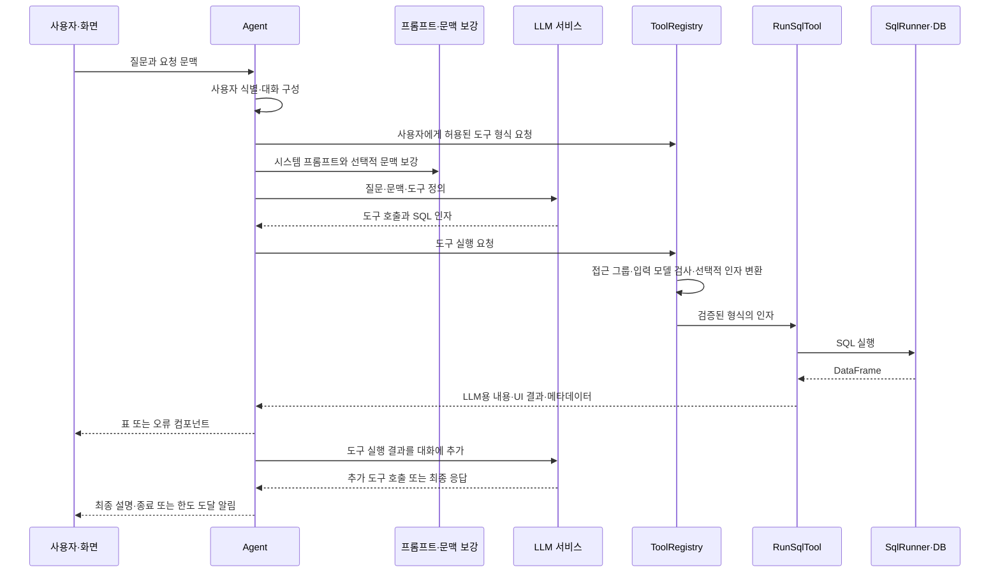

# Vanna 역분석

## 범위와 근거 기준

- 조사일: 2026-10-23, Asia/Seoul.
- 대상: [vanna-ai/vanna](https://github.com/vanna-ai/vanna).
- 기준 커밋: [`365d0617c1a4567ffee1b19b40c27feb4206bfcf`](https://github.com/vanna-ai/vanna/commit/365d0617c1a4567ffee1b19b40c27feb4206bfcf).
- `main` 참조가 위 커밋을 가리킴을 GitHub API로 확인했다.
- 버전: [`pyproject.toml` L5-L14](https://github.com/vanna-ai/vanna/blob/365d0617c1a4567ffee1b19b40c27feb4206bfcf/pyproject.toml#L5-L14)의 2.0.2. 저장소 메타데이터의 archived 값은 true.
- 범위: 공개 Quick Start·노트북, 2.x 에이전트 기본 경로, SQL·시각화 도구, DuckDB 실행기, 권한 레지스트리, 프롬프트·문맥 보강, legacy SQL 생성 경로.
- 방법: 공개 자료와 소스의 정적 추적. Vanna 설치, 예제 실행, 실 LLM 호출, 보안 공격 재현은 수행하지 않았다.

아래 "확인"은 해당 커밋의 소스 또는 문서를 직접 읽은 결과다. 실행 결과를 뜻하지 않는다. "자체 제안"은 InsightAgent에 도입할 설계이며 아직 구현되지 않았다.

## 1. 공개 예제에서 관찰한 입출력

[공식 Quick Start](https://vanna.ai/docs/quick-start)는 Chinook 음악 판매 샘플 DB와 앨범 매출·국가별 매출·트랙 수 질문을 안내한다. 공개 문서는 변경될 수 있으므로 실제 분석은 고정 커밋의 코드를 우선한다.

고정된 [Quickstart 노트북](https://github.com/vanna-ai/vanna/blob/365d0617c1a4567ffee1b19b40c27feb4206bfcf/notebooks/quickstart.ipynb)에는 다음 구성이 있다. 셀 번호는 0부터 센다.

- 셀 1·3: Vanna 패키지 설치와 Chinook SQLite 다운로드.
- 셀 7: 쿠키에서 사용자를 식별하고 그룹을 부여하는 예제. 실제 서비스용 인증 구현과 구분해야 한다.
- 셀 9: SQL·시각화·메모리 도구를 `register_local_tool`로 등록하고 접근 그룹을 설정.
- 셀 10: Anthropic LLM과 에이전트·서버 구성. NVIDIA 연결 예제가 아니다.
- 코드 셀의 execution_count는 null이며 저장된 실행 출력은 없었다. 이를 성공한 시연으로 취급하지 않는다.

2026-10-23 조사 당시 선택된 Python에 Vanna가 설치되어 있지 않았고, 이 프로젝트에 Chinook DB도 없었다. 실 예제 실행에는 추가 패키지·DB와 예제의 LLM 제공자 설정이 필요하므로 문서·소스 조사 범위에서 실행하지 않았다.

[모의 SQLite 예제](https://github.com/vanna-ai/vanna/blob/365d0617c1a4567ffee1b19b40c27feb4206bfcf/src/vanna/examples/mock_sqlite_example.py#L93-L115)는 고정 후보 중 무작위 SQL을 골라 도구를 호출한다. 도구 반환 후에는 그 내용을 응답한다. 따라서 이 예제를 실행하더라도 자연어→SQL 정확도 평가는 되지 않는다. 모의 토큰 사용량도 실 API 사용량이 아니다.

## 2. 질문에서 결과까지의 흐름

이 그림은 기본 코드 경로를 단순화했다. SQL 실행 전 별도의 SQL 안전성 검사가 항상 존재한다는 의미가 아니다.

핵심 위치는 [`Agent`](https://github.com/vanna-ai/vanna/blob/365d0617c1a4567ffee1b19b40c27feb4206bfcf/src/vanna/core/agent/agent.py)다. 사용자 식별 L257, 도구 형식 조회 L571, 프롬프트 구성·보강 L599-L615, 도구 반복 L643-L659, 도구 실행 L827, 도구 결과의 대화 추가 L987-L1012를 확인했다.

## 3. DB 스키마는 어떻게 전달되는가

**확인:** [`ToolRegistry.get_schemas()` L90-L96](https://github.com/vanna-ai/vanna/blob/365d0617c1a4567ffee1b19b40c27feb4206bfcf/src/vanna/core/registry.py#L90-L96)는 사용자가 호출 가능한 **도구 입력 형식**을 반환한다. 이는 테이블·컬럼·연결키를 설명하는 DB 스키마와 다르다.

- [`RunSqlToolArgs` L10-L13](https://github.com/vanna-ai/vanna/blob/365d0617c1a4567ffee1b19b40c27feb4206bfcf/src/vanna/capabilities/sql_runner/models.py#L10-L13)는 SQL 문자열 필드를 정의한다. 실제 테이블 구조를 자동으로 포함하지 않는다.
- [`DefaultSystemPromptBuilder` L47-L74](https://github.com/vanna-ai/vanna/blob/365d0617c1a4567ffee1b19b40c27feb4206bfcf/src/vanna/core/system_prompt/default.py#L47-L74)는 기본 안내와 사용 가능한 도구 정보를 구성한다. 확인한 기본 경로에서 DuckDB 테이블 전체를 자동 수집해 넣는 처리는 확인하지 못했다.
- [`DefaultLlmContextEnhancer` L41-L101](https://github.com/vanna-ai/vanna/blob/365d0617c1a4567ffee1b19b40c27feb4206bfcf/src/vanna/core/enhancer/default.py#L41-L101)는 설정된 메모리가 있으면 관련 텍스트를 검색해 프롬프트에 추가한다. 이 코드 자체는 DB 카탈로그 수집기가 아니다.
- legacy의 [`generate_sql()` L124-L136](https://github.com/vanna-ai/vanna/blob/365d0617c1a4567ffee1b19b40c27feb4206bfcf/src/vanna/legacy/base/base.py#L124-L136)는 유사 질문·SQL, 관련 DDL, 관련 문서를 검색해 SQL 생성 프롬프트를 구성한다. 이 흐름을 2.x의 기본 자동 동작이라고 혼동하지 않는다.

**자체 제안:** Phase 2에서 확인한 테이블·타입·키·실제 날짜 범위를 승인 KPI·기준 SQL과 함께 명시적으로 전달한다. MVP는 소수의 승인된 예시를 사용하고, 벡터 검색과 자동 메모리 학습은 도입하지 않는다.

## 4. SQL 생성과 실행의 분리

**확인:** LLM은 SQL을 포함한 도구 호출을 반환하고, 에이전트가 레지스트리에 실행을 요청한다. [`RunSqlTool.execute()` L56-L60](https://github.com/vanna-ai/vanna/blob/365d0617c1a4567ffee1b19b40c27feb4206bfcf/src/vanna/tools/run_sql.py#L56-L60)는 주입된 SqlRunner를 호출한다.

[`DuckDBRunner` L39-L65](https://github.com/vanna-ai/vanna/blob/365d0617c1a4567ffee1b19b40c27feb4206bfcf/src/vanna/integrations/duckdb/sql_runner.py#L39-L65)는 연결 인자를 받아 접속하고, `conn.query(args.sql).to_df()`로 SQL을 실행한다. 생성 모델과 DB 실행 구현을 교체할 수 있는 분리다.

**자체 제안:** LLM 어댑터 → SQL 안전성 검사기 → 제한된 실행기를 독립 구성한다. LLM에 DB 연결을 주지 않고, 실패 사유도 구분한다.

## 5. 권한과 SQL 안전성의 경계

**확인:** [`ToolRegistry` L98-L111](https://github.com/vanna-ai/vanna/blob/365d0617c1a4567ffee1b19b40c27feb4206bfcf/src/vanna/core/registry.py#L98-L111)는 사용자 그룹과 도구 접근 그룹을 대조한다. 접근 그룹이 비어 있으면 허용한다. 입력 모델 검사와 실제 실행 직전 권한 검사도 있다.

그러나 이 검사는 SQL 의미의 안전성 보장과 다르다.

- [`transform_args()` L113-L142](https://github.com/vanna-ai/vanna/blob/365d0617c1a4567ffee1b19b40c27feb4206bfcf/src/vanna/core/registry.py#L113-L142)는 인자 변환 확장 지점이다. 기본 구현은 인자를 그대로 반환한다. README의 행 수준 보안 설명만으로 기본 설정에 SQL 필터링이 적용된다고 판단할 수 없다.
- [`RunSqlTool` L59-L65](https://github.com/vanna-ai/vanna/blob/365d0617c1a4567ffee1b19b40c27feb4206bfcf/src/vanna/tools/run_sql.py#L59-L65)는 SQL 실행 **후** 첫 단어로 결과 처리 경로를 나눈다. SELECT 검사가 실행 전 차단 장치가 아니다.
- [`RunSqlTool` L127-L141](https://github.com/vanna-ai/vanna/blob/365d0617c1a4567ffee1b19b40c27feb4206bfcf/src/vanna/tools/run_sql.py#L127-L141)에는 변경 쿼리를 위한 결과 처리 경로도 있다.
- 같은 분기는 첫 단어가 `WITH`인 조회 SQL도 SELECT 결과 표시 경로로 분류하지 않는다. `WITH ... SELECT`가 성공하더라도 표 대신 비-SELECT 알림 경로로 처리될 수 있다는 정적 코드 해석이다. Vanna에서 이 문제를 실제 실행해 재현한 것은 아니다. 자체 구현에서는 조회 구문 검사와 결과셋 표현을 첫 단어만으로 결정하지 않는다.
- [`DuckDBRunner` L39-L65](https://github.com/vanna-ai/vanna/blob/365d0617c1a4567ffee1b19b40c27feb4206bfcf/src/vanna/integrations/duckdb/sql_runner.py#L39-L65)의 기본 인자는 읽기 전용을 강제하지 않는다. 외부에서 연결 인자를 설정하거나 추가 정책을 구현할 수 있으므로 모든 Vanna 배포가 같은 권한이라고 단정하지 않는다.

이는 확인한 기본 코드 경로의 범위 분석이며, 실제 취약점 공격이나 전체 배포에 대한 감사 결과가 아니다.

**자체 제안:** 허용 구문·테이블·함수 검사, 다중 문장·변경·외부 접근 차단, 읽기 전용 연결, 실행시간·메모리·반환 행 수 제한을 결합한다. 특히 SELECT로 시작하는 파일 읽기·고비용 쿼리도 별도 검증한다. 도구 선택 권한만으로 통과시키지 않는다.

## 6. 실행 결과와 시각화

**확인:** [`ToolResult` L47-L61](https://github.com/vanna-ai/vanna/blob/365d0617c1a4567ffee1b19b40c27feb4206bfcf/src/vanna/core/tool/models.py#L47-L61)는 성공 여부, LLM용 문자열, UI 컴포넌트, 오류, 메타데이터를 분리한다.

[`RunSqlTool` L85-L125](https://github.com/vanna-ai/vanna/blob/365d0617c1a4567ffee1b19b40c27feb4206bfcf/src/vanna/tools/run_sql.py#L85-L125)는 결과를 CSV로 저장하고, UI 표와 LLM용 미리보기를 만든다. LLM용 미리보기의 1,000자 제한은 DB가 계산·반환하는 행 수나 메모리를 제한하는 기능이 아니다.

[`VisualizeDataTool` L60-L97](https://github.com/vanna-ai/vanna/blob/365d0617c1a4567ffee1b19b40c27feb4206bfcf/src/vanna/tools/visualize_data.py#L60-L97)는 CSV를 읽어 DataFrame으로 복원하고 Plotly 생성기를 호출한다.

**자체 제안:** 로컬 실제 결과와 외부 모델용 제한된 집계 내용을 분리한다. 첫 MVP에서는 같은 실행 결과 DataFrame으로 표·차트를 만들고 도구 간 CSV 전달 단계를 줄인다. 그래프 유형은 검증된 코드로 선택한다.

## 7. 오류·수정·종료

**확인:** [`RunSqlTool` L150-L165](https://github.com/vanna-ai/vanna/blob/365d0617c1a4567ffee1b19b40c27feb4206bfcf/src/vanna/tools/run_sql.py#L150-L165)는 실행 예외를 실패 ToolResult와 UI 알림으로 변환한다. 레지스트리도 인자·권한·실행 오류를 구조화한다.

에이전트는 [`agent.py` L987-L1012](https://github.com/vanna-ai/vanna/blob/365d0617c1a4567ffee1b19b40c27feb4206bfcf/src/vanna/core/agent/agent.py#L987-L1012)에서 도구 결과 또는 오류를 대화에 추가한다. 모델이 이후 수정된 도구 호출을 할 여지는 있지만, SQL만 1회 수정하도록 제한된 전용 복구 상태 기계로 볼 수는 없다.

[`AgentConfig` L113-L121](https://github.com/vanna-ai/vanna/blob/365d0617c1a4567ffee1b19b40c27feb4206bfcf/src/vanna/core/agent/config.py#L113-L121)의 `max_tool_iterations` 기본값은 10이다. [`agent.py` L646-L659 및 L704](https://github.com/vanna-ai/vanna/blob/365d0617c1a4567ffee1b19b40c27feb4206bfcf/src/vanna/core/agent/agent.py#L646-L704)에서 카운터는 도구 호출을 포함한 LLM 응답 라운드마다 증가하며, 한 라운드에서 여러 도구가 실행될 수 있다. 따라서 이를 개별 SQL 실행 총횟수 상한으로 해석하면 안 된다. 한도 도달 알림은 L1045-L1073에 있다.

**자체 제안:** 접수 → 문맥 확인 → SQL 생성 → 검증 → 조회 → 결과 확인 → 표현 → 종료 상태를 둔다. 실패·정보 부족·데이터 부재·API 한도·호출 예산 소진은 이유를 남기고 종료한다. LLM 호출·SQL 수정·DB 실행 횟수를 별도 관리한다.

## 8. 문서와 코드의 불일치

**확인:** 고정 커밋의 [README 예제](https://github.com/vanna-ai/vanna/blob/365d0617c1a4567ffee1b19b40c27feb4206bfcf/README.md)는 `tools.register(...)`를 사용한다. 반면 실제 [`ToolRegistry` L63-L80](https://github.com/vanna-ai/vanna/blob/365d0617c1a4567ffee1b19b40c27feb4206bfcf/src/vanna/core/registry.py#L63-L80)와 Quickstart 노트북은 `register_local_tool(...)`를 사용한다. 해당 클래스에서 `register` 메서드는 확인되지 않았다.

따라서 README 예제를 그대로 복사해 실행 가능하다고 보장하지 않는다. 자료의 버전·커밋과 실제 정의를 함께 확인해야 한다. 이 불일치는 정적 확인이며 실행 오류를 재현한 결과는 아니다.

## 9. InsightAgent와의 차이

| 관찰 항목 | 확인한 Vanna 경로 | 자체 구현 제안 |
| --- | --- | --- |
| 서비스 범위 | 여러 LLM·DB·도구·사용자 그룹 | Olist·DuckDB·NVIDIA·로컬 단일 사용자 |
| 분석 문맥 | 도구 형식, 프롬프트 확장, 선택적 메모리; legacy의 DDL 검색 | 실측 스키마·기간·승인 KPI·기준 SQL을 명시 전달 |
| SQL 실행 | 주입 가능한 SqlRunner | 생성·검사·제한된 실행기를 독립 구성 |
| 권한·안전성 | 그룹 권한과 확장 지점; 기본 SQL 도구는 변경 쿼리 경로도 보유 | 조회 전용 정책과 별도 SQL·실행 환경 방어 |
| 반복 제한 | 도구 응답 라운드 한도 | LLM·수정·DB 실행 각각 상한과 종료 이유 |
| 결과 전달 | LLM용 문자열·UI·메타데이터·CSV | 같은 분리를 유지하되 로컬 DataFrame 중심으로 단순화 |
| 정확도 기준 | 이번 조사에서 Olist KPI 평가는 하지 않음 | 승인 KPI와 기준 SQL·예상값 테스트를 먼저 구축 |

## 10. 2026-10-24 재검토

사용자의 Phase 1 재검토·Phase 2 환경 설정 착수 요청에 따라 문서와 고정 커밋을 다시 대조했다. SQL 도구, DuckDB 실행기, 레지스트리, Agent, AgentConfig, SQL 입력 모델의 원본 6개 파일을 재조회했다.

| 원래 확인 항목 | 검토 결과 | 문서 근거 |
| --- | --- | --- |
| 질문 처리와 전체 데이터 흐름 | 정적 추적 완료 | 1·2절, 공개 노트북과 Agent |
| DB 스키마 전달 | 도구 스키마·DB 스키마·legacy 흐름을 구분 | 3절 |
| SQL 생성·실행 분리 | LLM 도구 호출·레지스트리·SqlRunner 경계 확인 | 4절 |
| 접근 권한·SQL 안전성 | 그룹 검사와 실제 SQL 정책의 차이 확인 | 5절 |
| 도구 결과·화면·시각화 | ToolResult·CSV·UI·Plotly 경로 확인 | 6절 |
| 오류·종료·수정 범위 | 구조화된 실패·반복 라운드 제한 확인 | 7절 |
| 버전·근거·자체 구현 차이 | 커밋·버전·코드 링크·비교 표 존재 | 범위, 8·9절 |

판정: 설계 역분석의 필수 조사 항목은 충족한다. 보완 사항은 완료 판단표, 조사 시점 표현, WITH 조회의 결과 분류 주의점이다. 기존 핵심 설명을 뒤집는 코드 불일치는 발견하지 못했다.

실행 시연·보안 차단·Text-to-SQL 정확도·성능까지 검증한 상태는 아니다. 원래 요청의 공개 예제 실행은 가능할 경우 수행하는 항목이며, 실행하지 못한 이유를 명시했다. 사용자의 이번 진행 요청에 따라 정적 역분석 검토를 마무리하고 Phase 2의 환경 설정을 시작한다. 학습 질문 답변은 아직 대기 중이다.

## 미검증과 다음 단계

- Vanna 실행 화면·브라우저 상호작용·실 SQL 결과·지연시간·실 토큰 사용량은 측정하지 않았다.
- 권한·SQL·자원 제한의 실제 차단 여부는 실행 검증하지 않았다.
- Olist 데이터의 기간·행 수·품질·KPI 값과 NVIDIA API 성공 여부는 확인하지 않았다.
- Phase 2 환경 설정 후 원본 데이터 위치를 확인한다. 데이터 조사·적재와 KPI 정의 승인은 이후 진행 항목이다.
